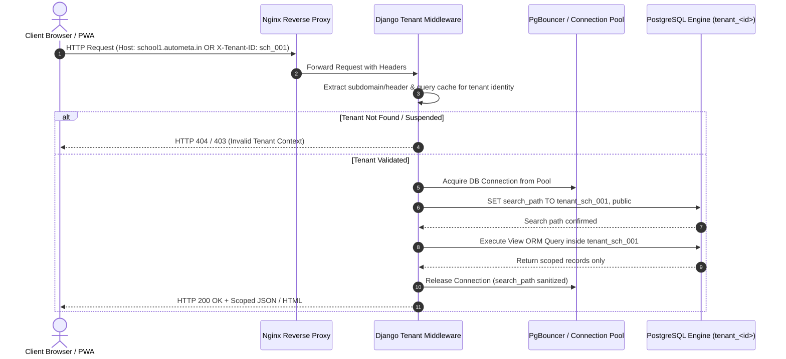
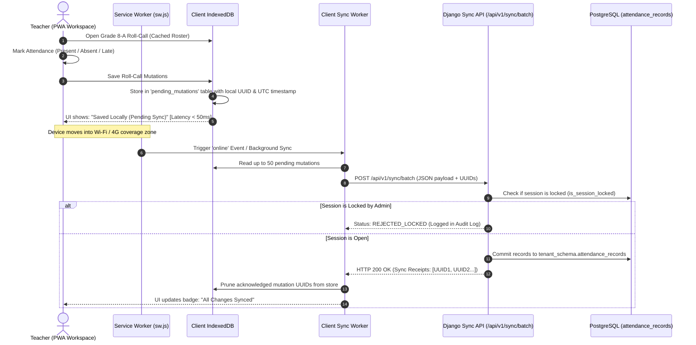
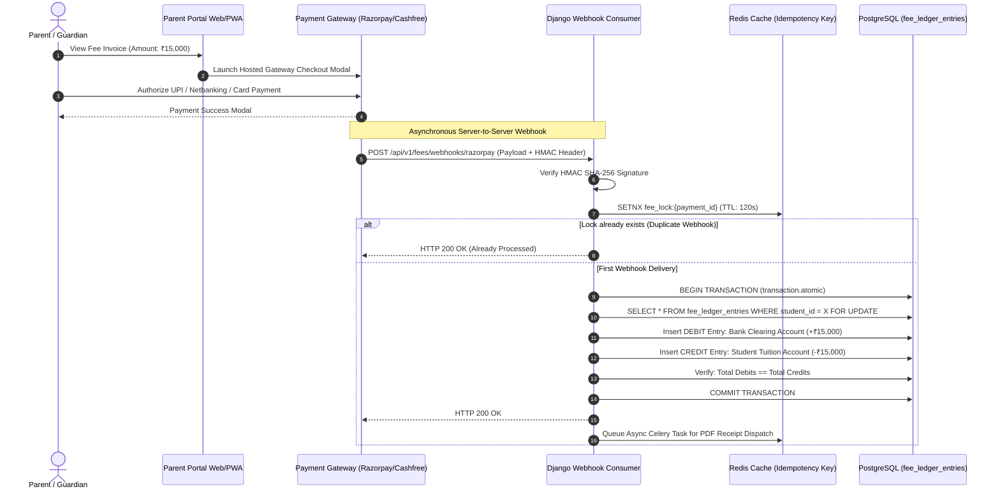
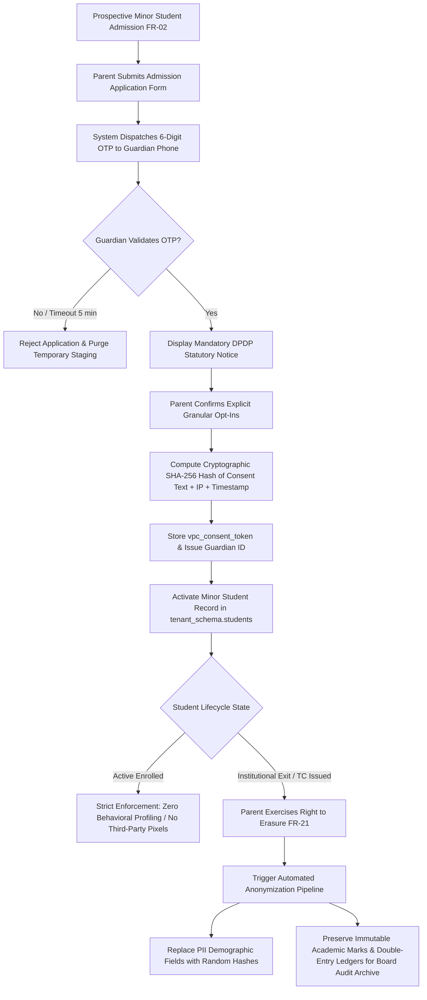
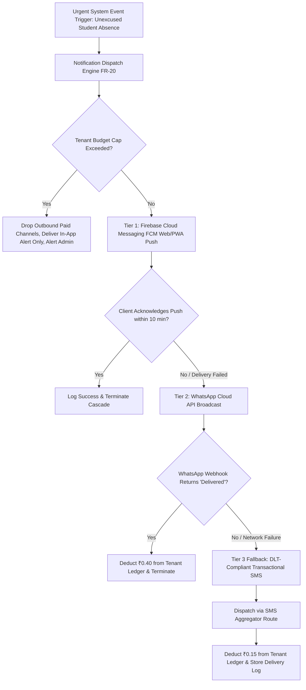

# Autometa School ERP Platform — System Architecture & Application Flow
**Document Version:** 1.0 (Baseline V3 Alignment)  
**Document Status:** Architecture Baseline  
**Stack Target:** HTML5, Tailwind CSS, Modern JS (PWA) | Django 5.x / DRF | PostgreSQL 15+  

---

## 1. Executive Architectural Overview

The **Autometa School ERP Platform** is designed as a secure, high-concurrency, multi-tenant Software-as-a-Service (SaaS) operating system. It powers administrative, academic, financial, and field operations across standalone campuses and federated multi-branch institutions.

The architecture emphasizes five foundational pillars:
1. **Schema-Based Multi-Tenancy**: Complete isolation of institutional data using dynamic PostgreSQL schemas (`tenant_<school_id>`), eliminating cross-tenant query contamination.
2. **Offline-First Field Workspaces**: Zero-latency classroom operations via Progressive Web Application (PWA) architecture utilizing Service Workers and client-side IndexedDB with background batch synchronization.
3. **Double-Entry Immutable Financial Accounting**: Financial records enforced through append-only ledgers, database triggers prohibiting destructive `UPDATE` or `DELETE` operations, and strict ACID transaction boundaries.
4. **Statutory Privacy by Design (DPDP Act 2023)**: Mandatory Verifiable Parental Consent (VPC), cryptographic terms hashing, strict purpose limitation, and automated right-to-erasure pipelines.
5. **High-Throughput Asynchronous Processing**: Decoupling long-running tasks (report card compilation, payroll calculation, notification dispatches) via Celery and Redis to maintain API response times under 250ms.

---

## 2. Technology Stack Specification

```
┌────────────────────────────────────────────────────────────────────────┐
│                        CLIENT PRESENTATION TIER                        │
│  • HTML5 Semantic App Shells (Fast SSR Paint & Screen Reader Support)  │
│  • Tailwind CSS (Responsive Utility Engine: 360px Mobile to 1920px+)   │
│  • Vanilla ES6+ JavaScript Modules (Lightweight, Zero Framework Bloat) │
│  • Progressive Web App (PWA) Shell: Service Worker + CacheStorage API  │
│  • Client-Side Persistence: IndexedDB (Local Queue up to 5,000 items)  │
└───────────────────────────────────┬────────────────────────────────────┘
                                    │ HTTPS (TLS 1.3) / WSS / SSE / REST
┌───────────────────────────────────▼────────────────────────────────────┐
│                    API GATEWAY & REVERSE PROXY TIER                    │
│  • Nginx / Caddy: TLS 1.3 Termination, HSTS (Strict-Transport-Security)│
│  • Rate Limiting: Token-bucket per IP / Endpoint (Burst: 7,000 RPS)    │
│  • Static Asset & Edge Caching: HTTP Caching, Brotli/Gzip Compression  │
└───────────────────────────────────┬────────────────────────────────────┘
                                    │ WSGI / ASGI (Unix Sockets / TCP)
┌───────────────────────────────────▼────────────────────────────────────┐
│                     APPLICATION CORE TIER (DJANGO)                     │
│  • Python 3.13 LTS + Django 5.x Framework                              │
│  • Django REST Framework (DRF): Serializers, Throttling, Renderers     │
│  • Tenant Middleware: search_path = tenant_<school_id>, public         │
│  • RBAC Evaluation Middleware: Gateway-level least-privilege checks   │
│  • Financial Ledger Engine: transaction.atomic() + select_for_update() │
│  • DPDP Statutory Interceptor: Minor VPC token validator               │
└───────────────────────────────────┬────────────────────────────────────┘
                  ┌─────────────────┴─────────────────┐
                  ▼                                   ▼
┌────────────────────────────────────┐ ┌─────────────────────────────────┐
│     ASYNC WORKER & CACHING TIER    │ │       DATABASE STORAGE TIER     │
│  • Redis 7+: Pub/Sub, Caching      │ │  • PostgreSQL 15+               │
│  • Celery 5.x Task Workers         │ │  • PgBouncer Connection Pooler  │
│  • Asynchronous PDF Generation     │ │  • Dynamic Tenant Schemas       │
│  • Multi-Tier Notification Cascade │ │  • Write-Ahead Logging (WAL)    │
│  • Monthly Payroll Computation     │ │  • Read Replicas (Async Reports)│
└────────────────────────────────────┘ └─────────────────────────────────┘
```

### 2.1 Detailed Component Stack

| Layer | Selected Technology | Architectural Purpose & Rationale |
| :--- | :--- | :--- |
| **Frontend Templates** | **HTML5 Semantic Templates** | Server-rendered through Django templates for ultra-fast initial Largest Contentful Paint (LCP < 2.0s) and seamless SEO/accessibility compliance. |
| **Frontend Styling** | **Tailwind CSS (v3/v4)** | Utility-first CSS compiling to a minimal footprint (< 40 KB compressed). Provides standardized design tokens across Admin, Teacher, Parent, and Student portals. |
| **Frontend Logic** | **Vanilla ES6+ JavaScript** | Avoids heavy JavaScript bundle runtimes, ensuring silky 50+ FPS interaction on low-cost Android hardware (2 GB RAM baseline). |
| **Offline Storage** | **Browser IndexedDB API** | Provides transactional client-side storage for offline roll-call rosters and examination mark sheets. |
| **PWA Runtime** | **Service Workers (`sw.js`)** | Manages offline resource caching (CacheStorage), background network sync, and Firebase Cloud Messaging (FCM) web push notifications. |
| **Backend Framework** | **Django 5.x (Python 3.13)** | Enterprise-grade ORM, robust session management, security middleware, and rapid development of multi-tenant domain models. |
| **API Architecture** | **Django REST Framework** | Provides clean RESTful endpoints, schema validation, rate-limiting, and standard JSON serialization. |
| **Database Engine** | **PostgreSQL 15+** | Relational integrity, JSONB support for flexible student demographics, and native multi-schema isolation (`tenant_<school_id>`). |
| **Connection Pooling**| **PgBouncer** | Maintains transaction-level connection pooling (20:1 multiplexing ratio), keeping database CPU overhead under 5%. |
| **Caching & Messaging**| **Redis 7+** | High-performance cache for 60-second KPI snapshots, short-lived OTP tokens, session blacklists, and Celery task broker. |
| **Task Queue** | **Celery 5.x** | Asynchronous workers handling background PDF generation, bulk email/SMS dispatches, and monthly payroll calculation runs. |
| **Document Storage** | **S3-Compatible Object Store** | AWS S3, Cloudflare R2, or MinIO for immutable PDF report cards, transfer certificates, and encrypted student identity uploads. |

---

## 3. End-to-End Application Flow Architecture

### Flow 1: Tenant Discovery & Dynamic Schema Routing
Every incoming request must be strictly isolated to the correct institution's schema before any database queries execute.



#### Routing Logic & Failsafe:
1. The middleware parses `request.get_host()` or reads `X-Tenant-ID`.
2. Resolves tenant metadata from Redis (cached with 1-hour TTL).
3. Executes `connection.cursor().execute(f"SET search_path TO {tenant_schema}, public")`.
4. If a query attempts cross-schema access or if no tenant context is found, the connection immediately aborts, preventing Insecure Direct Object References (IDOR).

---

### Flow 2: Offline-First Attendance Capture & Background Synchronization
Teachers operating in classrooms without active internet must have zero interruptions.



#### Conflict Resolution Rules:
* **Server-Authoritative Lock**: If an administrator has officially closed or frozen the daily attendance session, delayed offline entries are rejected and flagged for manual admin review.
* **Last-Write-Wins (LWW)**: For unlocked sessions, mutations with the latest verifiable client timestamp take precedence.
* **Sync Receipts**: The PWA client only deletes offline records from IndexedDB once the server returns explicit HTTP 200 receipt acknowledgments.

---

### Flow 3: Double-Entry Invoicing & Payment Gateway Webhook Reconciliation
Ensures zero balance mismatches and prevents duplicate payment crediting during concurrent network spikes.



#### Immutability & Audit Guarantee:
* Database triggers strictly reject any `UPDATE` or `DELETE` statement targeting `fee_ledger_entries`.
* If a fee adjustment or waiver is approved, an offsetting entry is inserted referencing the original `transaction_group_id`.

---

### Flow 4: DPDP Act 2023 Statutory Consent & Minor Data Lifecycle
Guarantees regulatory compliance under Indian data protection law for processing information of minors (< 18 years).



---

### Flow 5: Master Timetable Collision & Teacher Leave Substitution Solver
Guarantees that teacher absences are substituted in under 3 seconds without schedule or room collisions.

```mermaid
flowchart TD
    A[Teacher Anita Sharma Logs Morning Leave] --> B[Leave Approved by Principal / Coordinator]
    B --> C[Substitution Engine Triggered for Assigned Periods]
    C --> D[Identify Period Slot: Period 3, Class 10-A, Subject: Mathematics]
    
    D --> E[Step 1: Fetch All Teachers With FREE Status in Period 3]
    E --> F[Step 2: Filter Candidates by Qualification Domain 'Mathematics' or 'Science']
    F --> G[Step 3: Calculate Weekly Assigned Workload for Filtered Candidates]
    G --> H[Step 4: Rank Candidates Prioritizing Lowest Assigned Workload]
    
    H --> I{Candidates Available?}
    I -- No --> J[Heuristic Relaxation: Suggest Free Teacher from Adjacent Dept + Alert Admin]
    I -- Yes --> K[Top Recommendation: Rajesh Varma (Workload: 14 hrs vs Avg 22 hrs)]
    
    K --> L[Coordinator Clicks 'Confirm Allocation']
    L --> M[Update Timetable Slot in PostgreSQL]
    M --> N[Dispatch FCM Push Notification to Rajesh Varma with Class Details]
    M --> O[Refresh Teacher Portal Daily Schedule Grid via SSE Stream]
```

---

### Flow 6: Unified Multi-Tier Notification Dispatch Cascade
Guarantees reliable message delivery while managing outbound gateway expenditure through strict per-tenant budget caps.



---

## 4. Security, Cryptography & Network Architecture

### 4.1 Network Security & Transport Boundary
* **TLS 1.3 Mandatory**: Cleartext HTTP traffic on port 80 automatically redirects to HTTPS port 443 with HSTS headers:
  `Strict-Transport-Security: max-age=63072000; includeSubDomains; preload`
* **CORS & CSRF Defenses**: Strict Cross-Origin Resource Sharing whitelist per tenant domain. Django CSRF token middleware enforced on all mutable HTML form actions.

### 4.2 Authentication & Token Rotation Policy
```
User Login ──► Django Auth (/api/v1/auth/login)
                   │
                   ├─► Generates Short-Lived Access Token (15 min, RS256 signed JWT)
                   │    - Payload: { user_id, tenant_id, role, ward_ids: [...] }
                   │    - Transmitted in Authorization Header
                   │
                   └─► Generates Refresh Token (7 days, cryptographically secure random string)
                        - Persisted in database-backed rotation registry
                        - Set in HttpOnly, SameSite=Strict, Secure cookie
                        - Single-use rotation: Each refresh invalidates old token
```

### 4.3 Role-Based Access Control (RBAC) Matrix
Permissions are enforced at the API Gateway/Django View level using custom DRF permission classes (`HasTenantPermission`).

| Role | Students (FR-03) | Attendance (FR-07) | Fees & Ledger (FR-10) | Timetable (FR-06) | Exam Marks (FR-09) | Admin Settings (FR-21) |
| :--- | :---: | :---: | :---: | :---: | :---: | :---: |
| **Super Admin** | Full (All Tenants) | Audit Only | Audit Only | Audit Only | Audit Only | Full Access |
| **Principal** | Full (Campus) | Review & Lock | Review & Waive | Review & Publish| Final Approve | Campus Settings |
| **Academic Coord** | View Only | Review | No Access | Full Master Control | Review | Term Config |
| **Accountant** | View Demographics | No Access | Full (Post/Reconcile)| No Access | No Access | Ledger Config |
| **Teacher** | Assigned Section | Mark / Edit (Own) | No Access | Personal View | Enter Marks | No Access |
| **Parent** | Own Ward(s) Only | View Ward Daily | Pay / View Invoices | View Ward Schedule | View Ward Cards | DPDP VPC Settings|
| **Student** | Own Profile | View Own % | View Invoices | View Own Schedule | View Published | No Access |

---

## 5. Storage & Database Schema Segregation

```
PostgreSQL Database Cluster
├── public Schema
│   ├── tenants_tenant (id, code, name, schema_name, is_active, created_at)
│   ├── tenants_domain (id, domain, tenant_id, is_primary)
│   ├── global_feature_flags (id, flag_key, is_enabled)
│   └── system_audit_archive (id, tenant_code, event_type, payload, logged_at)
│
└── tenant_<school_id> Schemas (Dynamic per registered campus)
    ├── auth_users (id, username, email, password_hash, role_id)
    ├── auth_roles_permissions (role_id, permission_id)
    ├── students (id, admission_no, first_name, vpc_consent_token, profile_data JSONB)
    ├── guardians (id, phone_hash, vpc_verified_at)
    ├── student_guardians (student_id, guardian_id, relationship)
    ├── attendance_records (id, student_id, date, status, offline_sync_uuid, is_locked)
    ├── fee_ledger_entries (id, transaction_group_id, debit/credit, amount, idempotency_key)
    ├── fee_structures (id, name, term, amount, account_code)
    ├── academic_years & terms (id, name, start_date, end_date, is_locked)
    ├── grades & sections (id, name, board_type)
    ├── timetable_slots (id, day_of_week, period_number, section_id, teacher_id, room_id)
    └── exam_gradebooks (id, exam_id, student_id, marks_data JSONB, is_approved)
```

---

## 6. Deployment & Physical Topology

```
                          [ Internet Traffic ]
                                   │
                                   ▼
                   ┌───────────────────────────────┐
                   │ Cloudflare / CDN Edge Network │
                   │  - WAF & DDoS Shielding       │
                   │  - Edge Asset Caching         │
                   └───────────────┬───────────────┘
                                   │ HTTPS (Port 443)
                                   ▼
                   ┌───────────────────────────────┐
                   │    Nginx Reverse Proxy Pods   │
                   │  - TLS 1.3 Termination        │
                   │  - Subdomain & Tenant Header  │
                   └───────────────┬───────────────┘
                                   │ Reverse Proxy
                                   ▼
                   ┌───────────────────────────────┐
                   │  Django Gunicorn Application  │
                   │  - Dynamic Schema Middleware  │
                   │  - DRF API & Template Engines │
                   └───────────────┬───────────────┘
                                   │
        ┌──────────────────────────┼──────────────────────────┐
        │                          │                          │
        ▼                          ▼                          ▼
┌───────────────┐          ┌───────────────┐          ┌───────────────┐
│ PgBouncer     │          │ Redis Cluster │          │ Celery Worker │
│ Pooler Pods   │          │ (Broker/Cache)│          │ Nodes (Tasks) │
└───────┬───────┘          └───────────────┘          └───────────────┘
        │
        ▼
┌───────────────────────────────┐
│ PostgreSQL 15+ Master Cluster │
│  - tenant_<school_id> schemas │
│  - WAL Streaming to S3        │
└───────────────┬───────────────┘
                │ Asynchronous Streaming Replication
                ▼
┌───────────────────────────────┐
│ PostgreSQL Read-Only Replica  │
│  - Heavy Reports (FR-17)      │
│  - Student Read Portals       │
└───────────────────────────────┘
```

---

## 7. Architectural Verification & Acceptance Checklist

To guarantee compliance with the SRS baseline before release, every build must verify:
* [x] **Zero Cross-Tenant Leakage**: Automated integration tests asserting that connection pool reuse never reveals tables or rows from adjacent schemas.
* [x] **Offline Synchronization Recovery**: Simulating an offline state, queuing 50 attendance mutations in IndexedDB, and verifying successful commit within 1.5 seconds upon reconnection.
* [x] **Ledger Immutability**: Verification that raw SQL `UPDATE` and `DELETE` queries on `fee_ledger_entries` throw PostgreSQL exceptions.
* [x] **DPDP Act 2023 Audit**: Confirmation that minor accounts cannot be created without a valid cryptographic `vpc_consent_token` and verified parent OTP.
* [x] **P95 Latency Conformance**: All cached CRUD reads return within 250ms under baseline loads.
