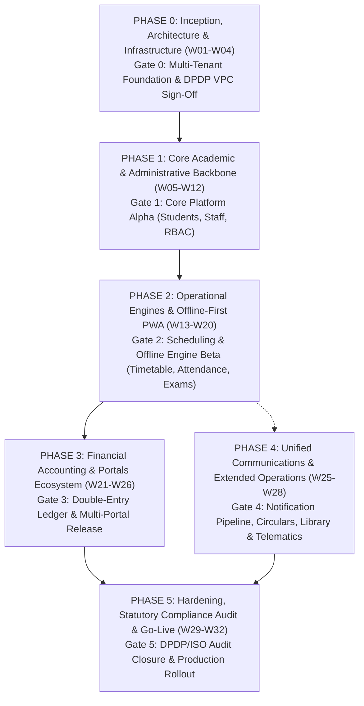

# Project Phasing & Work Breakdown Structure (WBS)
## Autometa School Enterprise Resource Planning (ERP) Platform
**Document Version:** 1.0 (Baseline V3 Alignment)  
**Total Schedule:** 32 Weeks (Milestone-Driven Agile Delivery)  
**Stack Target:** HTML5, Tailwind CSS, Modern JS (PWA) | Django 5.x / DRF | PostgreSQL 15+  
**Target Completion:** Production Go-Live & Pilot Rollout  

---

## 1. Executive Phasing Master Roadmap

The implementation is broken down into **six structured phases (Phase 0 through Phase 5)**. Each phase represents a deployable milestone bounded by formal acceptance criteria and statutory compliance sign-offs.



### 1.1 Master Phasing Timeline & Scope Overview

| Phase | Workstream Focus | Duration | Start Wk | End Wk | Covered Modules | Milestone Gate |
| :--- | :--- | :--- | :--- | :--- | :--- | :--- |
| **Phase 0** | **Inception & Multi-Tenancy Architecture** | 4 Weeks | W01 | W04 | Foundation, RBAC base, VPC specs | **M0: Architecture Sign-Off** |
| **Phase 1** | **Core Academic & Admin Backbone** | 8 Weeks | W05 | W12 | FR-03, FR-04, FR-05, FR-19, FR-21 | **M1: Core Platform Alpha** |
| **Phase 2** | **Critical Operational & Offline Engines** | 8 Weeks | W13 | W20 | FR-06, FR-07, FR-09 | **M2: Offline & Engine Beta** |
| **Phase 3** | **Financial Accounting & Portals** | 6 Weeks | W21 | W26 | FR-10, FR-11, FR-12, FR-13 | **M3: Financial & Portal Release** |
| **Phase 4** | **Comms, Documents & Extended Ops** | 4 Weeks | W25 | W28 | FR-08, FR-14, FR-15, FR-16, FR-18, FR-20 | **Feature Complete Scope** |
| **Phase 5** | **Hardening, Compliance & Go-Live** | 4 Weeks | W29 | W32 | Full System, VAPT, DPDP Audit | **M4: Production Go-Live** |

---

## 2. Phase-by-Phase Detailed Engineering Breakdown

---

### PHASE 0: Inception, Architecture & Infrastructure
**Duration:** Weeks 01 – 04 (4 Weeks)  
**Primary Focus:** Foundational multi-tenancy schema routing, Docker containerization, Tailwind PWA app shell, and DPDP consent architecture.

#### Part 0.1: Multi-Tenant Database Architecture
* [x] **T0.1.1**: Set up PostgreSQL 15+ cluster with PgBouncer connection multiplexer (transaction mode, 20:1 pooling).
* [x] **T0.1.2**: Implement `public` schema tables (`tenants_tenant`, `tenants_domain`, `global_feature_flags`).
* [x] **T0.1.3**: Develop dynamic tenant provisioning script creating isolated `tenant_<school_id>` schemas.
* [x] **T0.1.4**: Build custom Django database routing middleware enforcing:
  `SET search_path TO tenant_<school_id>, public;`
* [x] **T0.1.5**: Write multi-tenant isolation unit test suite verifying zero cross-tenant query leakage.

#### Part 0.2: Frontend App Shell & Design System Tokens
* [x] **T0.2.1**: Initialize Tailwind CSS compiler pipeline with custom colors, tabular typography (`Inter`, `JetBrains Mono`), and responsive breakpoints.
* [x] **T0.2.2**: Build reusable semantic HTML5 base layouts (`base.html`, `sidebar.html`, `header.html`).
* [x] **T0.2.3**: Scaffold Progressive Web App (PWA) App Shell: `manifest.json` and basic Service Worker (`sw.js`).
* [x] **T0.2.4**: Implement dynamic PWA network connectivity banner (*Online*, *Offline*, *Synchronizing*).

#### Part 0.3: Security & Statutory DPDP Foundation
* [x] **T0.3.1**: Configure JWT authentication architecture (RS256 asymmetric keys, 15-minute access, 7-day refresh in `HttpOnly` cookies).
* [x] **T0.3.2**: Formalize DPDP Verifiable Parental Consent (VPC) cryptographic hashing specification (SHA-256 consent token schema).

> **Gate 0 Verification Criteria**:
> - Multi-tenant schema switching executes in under 5ms without connection leakage.
> - PWA Shell installs and renders offline on test Android device.
> - DPDP consent data flows approved by legal/compliance review.

---

### PHASE 1: Core Academic & Administrative Backbone
**Duration:** Weeks 05 – 12 (8 Weeks)  
**Primary Focus:** Central student demographic records, staff directory, biometric payroll, board curriculum hierarchy, and RBAC governance.

#### Part 1.1: User & Granular RBAC Engine (FR-19 & FR-21)
* [ ] **T1.1.1**: Define custom Django User model (`auth_users`) and RBAC permission matrices per tenant schema.
* [ ] **T1.1.2**: Implement DRF authentication endpoints (`/api/v1/auth/login`, `/api/v1/auth/token/refresh`, `/api/v1/auth/mfa/verify`).
* [ ] **T1.1.3**: Build custom DRF permission class `HasTenantPermission` enforcing endpoint-level security.
* [ ] **T1.1.4**: Implement immutable append-only audit trail logging table (`audit_logs`) tracking administrative logins and updates.

#### Part 1.2: 360° Student Lifecycle & Demographics (FR-03 & FR-02)
* [ ] **T1.2.1**: Implement `students`, `guardians`, and `student_guardians` models with JSONB demographic fields.
* [ ] **T1.2.2**: Build student admission CRM pipeline (`enquiries`) with state machine transitions.
* [ ] **T1.2.3**: Build guardian mobile OTP validation service (Redis 5-minute expiry) and DPDP consent token binder.
* [ ] **T1.2.4**: Create Admin HTML/Tailwind student management interface (data tables, filter by grade/section, bulk upload via CSV).
* [ ] **T1.2.5**: Implement student promotion and statutory soft-deletion / anonymization routines.

#### Part 1.3: Multi-Board Academic Management (FR-05)
* [ ] **T1.3.1**: Build academic hierarchy models: `Board` (CBSE, ICSE, IB, State) $\rightarrow$ `AcademicYear` $\rightarrow$ `Grade` $\rightarrow$ `Section` $\rightarrow$ `Subject`.
* [ ] **T1.3.2**: Implement section allocation rules preventing duplicate subject assignments per section.
* [ ] **T1.3.3**: Create Academic Coordinator UI for configuring multi-term academic calendars and subject-class mappings.

#### Part 1.4: Staff / HR & Automated Payroll Computation (FR-04)
* [ ] **T1.4.1**: Build employee lifecycle models: `staff_members`, `departments`, `designations`, `leave_balances`.
* [ ] **T1.4.2**: Implement biometric ingestion endpoint (`POST /api/v1/hr/biometric/ingest`) with device HMAC authentication.
* [ ] **T1.4.3**: Develop Celery background worker for monthly payroll computation:
  `Net Salary = Base + Allowances - (Tax + PF + ESI) - Unpaid Leave Deductions`.
* [ ] **T1.4.4**: Build printable PDF salary slip generator formatted for standard A4 output.

> **Gate 1 Verification Criteria**:
> - 10,000 student records indexed and searchable in under 250ms.
> - Monthly payroll calculation matches formulas to within ₹0.00 rounding.
> - Minor student accounts blocked from activation until guardian OTP and VPC token are confirmed.

---

### PHASE 2: Critical Operational & Offline Engines
**Duration:** Weeks 13 – 20 (8 Weeks)  
**Primary Focus:** Automated master timetable scheduling, sub-3s teacher substitution solver, offline-first PWA attendance, and audit-locked examination gradebooks.

#### Part 2.1: Automated Timetable & Substitution Engine (FR-06)
* [ ] **T2.1.1**: Build relational timetable models: `timetable_slots`, `classroom_facilities`, `teacher_allocations`.
* [ ] **T2.1.2**: Implement hard/soft constraint validation engine (zero teacher double-booking, zero room collision).
* [ ] **T2.1.3**: Build the **Automated Teacher Substitution Solver**:
  * Event listener on teacher leave approval.
  * Filters free teachers in the designated period slot.
  * Filters by matching department qualification (e.g., Math/Science).
  * Ranks candidates by lowest weekly assigned workload.
  * Response SLA: Returns top recommendations in $< 3\text{ seconds}$.
* [ ] **T2.1.4**: Build dynamic timetable grid UI in HTML/Tailwind with visual collision warnings and PDF schedule export.

#### Part 2.2: Offline-First PWA Attendance Management (FR-07)
* [ ] **T2.2.1**: Implement client-side IndexedDB database (`idb`) with stores: `rosters` and `pending_mutations`.
* [ ] **T2.2.2**: Build touch-friendly Teacher Roll-Call interface (large buttons $\ge 44 \times 44\text{ px}$ for *Present*, *Absent*, *Late*, *Excused*).
* [ ] **T2.2.3**: Implement Service Worker background sync engine flushing mutations to `/api/v1/sync/batch`.
* [ ] **T2.2.4**: Build backend attendance conflict resolver:
  * Server-authoritative check verifying if academic session is `is_session_locked`.
  * Commit to PostgreSQL `attendance_records` and return UUID receipts for client IndexedDB pruning.
* [ ] **T2.2.5**: Trigger automated absentee parent notification cascade (SMS/Push) within 15 minutes of session lock.

#### Part 2.3: Examination & Audit-Locked Gradebooks (FR-09)
* [ ] **T2.3.1**: Build exam management models: `assessments`, `grading_scales`, `student_marks`.
* [ ] **T2.3.2**: Implement decoupled board grading adapters (CBSE CCE, percentage marks, IB criterion 1–7).
* [ ] **T2.3.3**: Develop offline-capable teacher marks entry sheet with local caching in IndexedDB.
* [ ] **T2.3.4**: Implement database trigger-level gradebook lock preventing post-approval mark tampering.
* [ ] **T2.3.5**: Build Celery asynchronous batch PDF report card generator (compiles 1,000 cards in $< 3\text{ minutes}$).

> **Gate 2 Verification Criteria**:
> - 50 attendance records entered offline synchronize within 1.5 seconds upon network recovery on simulated 3G.
> - Substitution solver suggests zero-conflict substitute in $< 3$ seconds.
> - Locked gradebooks strictly reject modifications without authorized admin override.

---

### PHASE 3: Financial Accounting & Portals Ecosystem
**Duration:** Weeks 21 – 26 (6 Weeks)  
**Primary Focus:** Double-entry immutable fee ledgers, payment gateway reconciliation (Razorpay/Cashfree), and dedicated role portals for Parents, Teachers, and Students.

#### Part 3.1: Double-Entry Immutable Fee Management (FR-10)
* [ ] **T3.1.1**: Build relational ledger schema: `fee_structures`, `fee_categories`, `fee_ledger_entries`.
* [ ] **T3.1.2**: Write PostgreSQL trigger `trg_protect_fee_ledger` preventing direct SQL `UPDATE` or `DELETE` statements.
* [ ] **T3.1.3**: Implement atomic transaction wrapper (`transaction.atomic()` with `select_for_update()`) ensuring every invoice credit is balanced by an offsetting bank/cash debit.
* [ ] **T3.1.4**: Build webhook ingestion endpoints for Razorpay and Cashfree with HMAC SHA-256 signature verification and Redis idempotency locks.
* [ ] **T3.1.5**: Implement sequential digital receipt generation formatted for 80 mm thermal rolls and standard A4 sheets.

#### Part 3.2: Parent Portal & Multi-Child Context Switcher (FR-11)
* [ ] **T3.2.1**: Build parent portal UI with prominent child-switcher dropdown (JWT claims carry authorized ward IDs).
* [ ] **T3.2.2**: Implement ward daily attendance timeline and term academic progress graphs.
* [ ] **T3.2.3**: Integrate Razorpay/Cashfree online checkout modal with instant receipt download.
* [ ] **T3.2.4**: Implement DPDP privacy center allowing parents to view consent logs and manage preferences.

#### Part 3.3: Teacher & Student Portals (FR-12 & FR-13)
* [ ] **T3.3.1**: Build Teacher PWA workspace: today's schedule, 1-tap roll-call launcher, pending substitution requests.
* [ ] **T3.3.2**: Build Student read-mostly portal: personalized timetable, published exam results, homework feed, and issued library books.
* [ ] **T3.3.3**: Enforce strict IDOR tests ensuring parents and students can never access records outside their authorized family context.

> **Gate 3 Verification Criteria**:
> - Total debit and credit lines in `fee_ledger_entries` maintain zero imbalance across all simulated test transactions.
> - Replayed or delayed payment webhooks rejected idempotently without double-crediting.
> - Parent portal securely switches between multiple enrolled siblings without full re-login.

---

### PHASE 4: Unified Communications, Documents & Extended Operations
**Duration:** Weeks 25 – 28 (4 Weeks)  
**Primary Focus:** Multi-tier notification cascade, circulars, cryptographic QR certificates, library desk, and transport tracking.

#### Part 4.1: Unified Multi-Tier Notification Pipeline (FR-20)
* [ ] **T4.1.1**: Implement priority message queue (RabbitMQ / Redis) for dispatch orchestration.
* [ ] **T4.1.2**: Integrate Tier 1: Firebase Cloud Messaging (FCM) web push notifications to PWA shells.
* [ ] **T4.1.3**: Integrate Tier 2: WhatsApp Cloud API for high-priority unread alerts and fee receipts.
* [ ] **T4.1.4**: Integrate Tier 3: DLT-compliant transactional SMS fallback route.
* [ ] **T4.1.5**: Build per-tenant monthly notification budget caps and cost ledger tracking.

#### Part 4.2: Institutional Circulars & Notices (FR-16)
* [ ] **T4.2.1**: Build circular creation engine with audience query builder (filter by Grade, Section, Role).
* [ ] **T4.2.2**: Implement approval workflow requiring Principal sign-off before broadcasting to parents.
* [ ] **T4.2.3**: Build emergency broadcast override bypassing standard queues for urgent school closures.

#### Part 4.3: Document Management & Verifiable Certificates (FR-18)
* [ ] **T4.3.1**: Implement automated PDF generator for Transfer Certificates (TC) and Bonafide Certificates.
* [ ] **T4.3.2**: Embed cryptographically hashed QR codes pointing to public verification endpoint:
  `/public/verify/{certificate_hash}`.

#### Part 4.4: Extended Modules: Library & Fleet Telematics (FR-14 & FR-15)
* [ ] **T4.4.1**: Build Library circulation desk: ISBN cataloging, HTML5 camera barcode/QR scanner, overdue fine engine.
* [ ] **T4.4.2**: Build Transport module: vehicle fleet inventory, bus routes, stop mapping, and GPS telemetry ingestion webhook.

> **Gate 4 Verification Criteria**:
> - Simulating FCM failure triggers automated cascade to WhatsApp and SMS within 30 seconds.
> - Public scan of certificate QR code resolves authenticity status in $< 500\text{ms}$.
> - Circular broadcasts reach 10,000 recipient queues within 5 minutes.

---

### PHASE 5: Hardening, Statutory Compliance Audit & Pilot Rollout
**Duration:** Weeks 29 – 32 (4 Weeks)  
**Primary Focus:** DPDP Act legal audit closure, ISO 27001 readiness, load testing (50k concurrent users), pilot school beta, and production handover.

#### Part 5.1: Statutory DPDP Act 2023 & ISO 27001 Audit Closure
* [ ] **T5.1.1**: Formal legal and data privacy audit sign-off on minor consent capture and retention policies.
* [ ] **T5.1.2**: Verify automated Right to Erasure / pseudonymization pipeline cleanses PII while preserving board records.
* [ ] **T5.1.3**: Conduct independent Vulnerability Assessment and Penetration Testing (VAPT).
* [ ] **T5.1.4**: Verify zero third-party advertising tags or behavioral tracking pixels exist across all portal bundles.

#### Part 5.2: High-Concurrency Load Testing & Performance Tuning
* [ ] **T5.2.1**: Run Locust / k6 load tests simulating 15,000 baseline concurrent users and 50,000 peak result-day surge.
* [ ] **T5.2.2**: Validate sustained throughput of 3,500 RPS and burst capacity of 7,000 RPS.
* [ ] **T5.2.3**: Confirm P95 response times: cached reads $\le 250\text{ms}$, synchronous ledger writes $\le 350\text{ms}$.
* [ ] **T5.2.4**: Verify Horizontal Pod Autoscaling (HPA) triggers pod scale-up when CPU exceeds 70% for 90 seconds.

#### Part 5.3: Pilot Campus Beta Launch & Production Handover
* [ ] **T5.3.1**: Onboard initial pilot campus onto production cluster; verify tenant provisioning script.
* [ ] **T5.3.2**: Execute staff onboarding and teacher PWA offline training session.
* [ ] **T5.3.3**: Execute shadow-run of morning roll-call, timetable substitutions, and fee collections.
* [ ] **T5.3.4**: Final operational sign-off and production handover.

> **Gate 5 Verification Criteria**:
> - Independent VAPT audit reports zero High or Critical vulnerabilities.
> - Core cluster delivers 99.9% uptime with RPO $\le 5$ min and RTO $\le 30$ min.
> - Production deployment complete.

---

## 3. Cross-Phase Technical Dependency Matrix

```
┌──────────────┐     ┌──────────────┐     ┌──────────────┐
│   Phase 0    │────►│   Phase 1    │────►│   Phase 2    │
│ Multi-Tenant │     │ Student/HR   │     │ Timetable/   │
│ Architecture │     │ Academic Core│     │ Attendance   │
└──────────────┘     └──────────────┘     └──────┬───────┘
                                                 │
                     ┌──────────────┐            │
                     │   Phase 4    │◄───────────┤
                     │ Notification/│            ▼
                     │ Comms/Docs   │     ┌──────────────┐
                     └──────┬───────┘     │   Phase 3    │
                            │             │ Fee Ledger/  │
                            │             │ Portals      │
                            │             └──────┬───────┘
                            ▼                    │
                     ┌──────────────┐            │
                     │   Phase 5    │◄───────────┘
                     │ Hardening &  │
                     │ Go-Live      │
                     └──────────────┘
```

---

## 4. Human Resource Allocation Across Phases

| Engineering Role | Headcount | Allocation | Active Window | Primary Responsibilities |
| :--- | :---: | :---: | :--- | :--- |
| **Solutions / System Architect** | 1 | 100% | W01 – W32 | Multi-tenant schema design, PWA sync architecture, DPDP compliance. |
| **Lead Backend Engineers (Django/Postgres)** | 2 | 100% | W01 – W32 | Schema isolation, REST APIs, double-entry ledger, Celery queues. |
| **Frontend / PWA Engineers (HTML/Tailwind/JS)**| 2 | 100% | W01 – W32 | Portal layouts, Service Workers, IndexedDB sync engine, PWA shell. |
| **Algorithm / Optimization Specialist** | 1 | 50% | W09 – W20 | Constraint solver for timetable generation & sub-3s substitution engine. |
| **UI / UX Designer** | 1 | 100% / 50% | W01 – W28 | Portal wireframes, roll-call touch patterns, responsive design tokens. |
| **QA / Automation Engineers** | 2 | 100% | W05 – W32 | BDD test execution, offline sync dropout tests, load & stress tests. |
| **DevOps & Cloud Security Specialist** | 1 | 100% | W01 – W32 | Kubernetes clusters, PgBouncer pooling, Redis, CI/CD, backup automation. |
| **Technical Project Manager / Scrum Master** | 1 | 100% | W01 – W32 | Sprint ceremonies, milestone tracking, regulatory sign-offs. |

---

## 5. Phase Sign-Off & Verification Checklist

Before advancing between milestone gates, the Technical Project Manager and Lead Architect must sign off on the following:

- [ ] **Phase 0 Gate**: PostgreSQL schema-switching confirmed; zero cross-tenant query leakage in automated test harness; DPDP consent token structure approved.
- [ ] **Phase 1 Gate**: 360° student records persisted across sessions; staff payroll calculations match base minus deductions to ₹0.00; RBAC gateway middleware verified.
- [ ] **Phase 2 Gate**: Offline PWA attendance syncs 50 records within 1.5s on 3G; substitution algorithm resolves under 3s; gradebook database lock operational.
- [ ] **Phase 3 Gate**: Immutable fee ledger lines balance (`Debits == Credits`); payment gateway webhooks verified with HMAC; parent portal multi-child switcher functional.
- [ ] **Phase 4 Gate**: Notification cascade routes FCM $\rightarrow$ WhatsApp $\rightarrow$ SMS; certificate QR codes verify correctly; circular broadcasts queue within 5 minutes.
- [ ] **Phase 5 Gate**: VAPT penetration tests clear; DPDP Act audit signed off; 50,000 concurrent user surge verified; production release approved.
